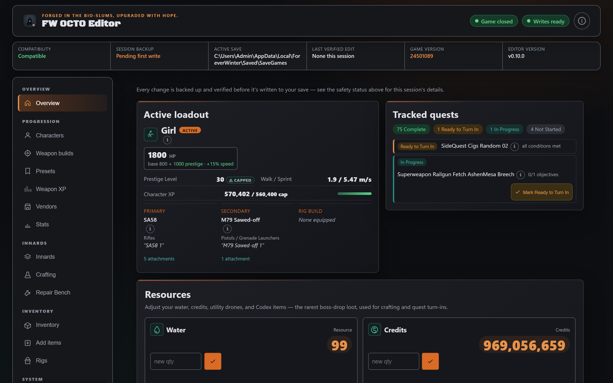
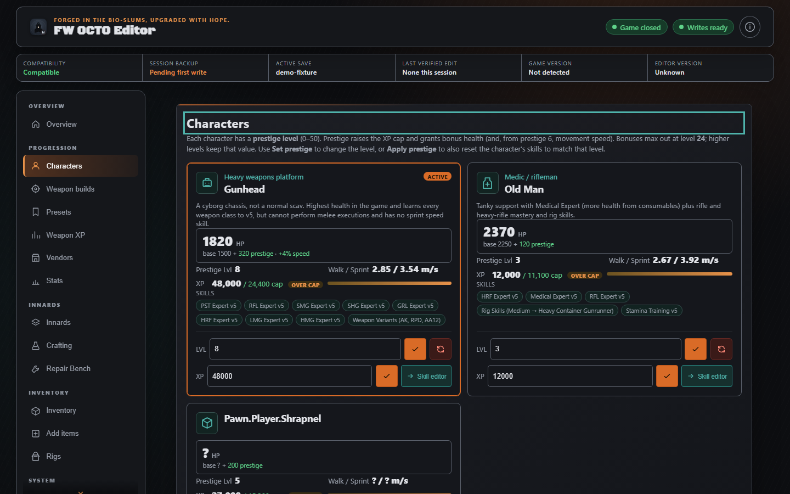
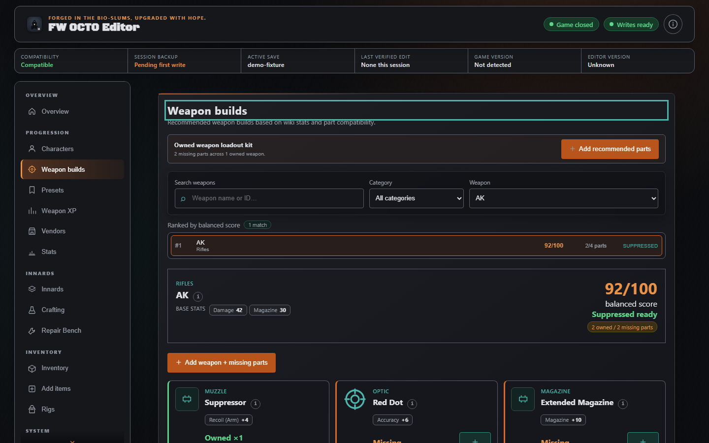
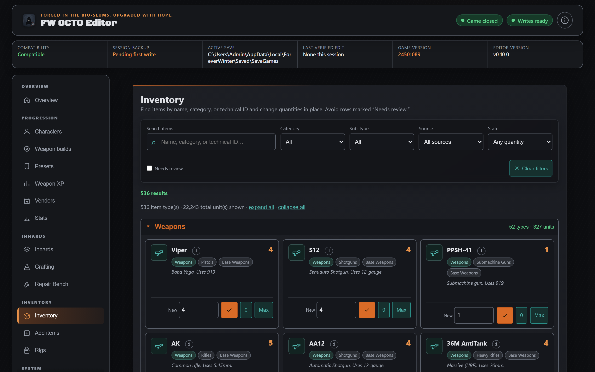
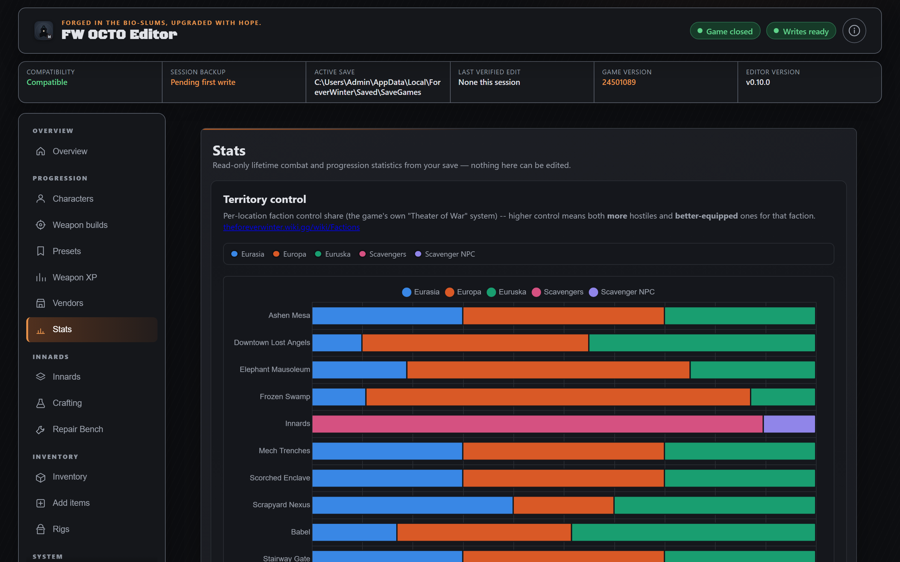
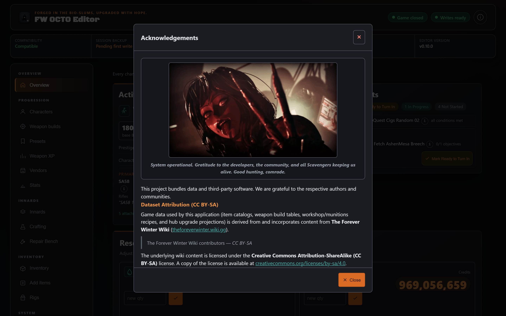

<div align="center">

# FW OCTO Editor

**Safely read and edit *The Forever Winter* encrypted saves. Local only, staged writes, automatic backups.**

[](https://github.com/butteredstardust/fw-octo-editor/releases/latest)
[](https://github.com/butteredstardust/fw-octo-editor/actions/workflows/release.yml)
[](webapp/LICENSE)
[](https://nodejs.org)
[](https://github.com/butteredstardust/fw-octo-editor/releases/latest)

</div>

A local, loopback-only Node.js/Express web application for safely reading and editing *The Forever Winter* encrypted save files. It provides a browser-based UI for modifying character progression, inventory, currencies, hub upgrades, weapon XP, vendor reputations, and more—with staged copy-on-write mutations, automatic backups, and byte-level integrity verification.

| Overview | Progression and inventory |
|---|---|
|  |  |
| Active character, resources, loadout, and quest snapshot. | Character progression and prestige controls. |
|  |  |
| Best-in-slot build recommendations and owned-part actions. | Searchable, categorized inventory quantities. |
|  |  |
| Lifetime combat, map, and territory statistics. | Attribution, licenses, and the single-player disclaimer. |

## Tech Stack Overview

| Category       | Technology / Detail |
|----------------|---------------------|
| Runtime        | Node.js (no build step) |
| Framework      | Express 4.x |
| Database       | SQLite3MC (encrypted SQLite, `cipher_compatibility = 3`) |
| GVAS Engine    | trumank/uesave (Rust CLI, pinned v0.7.1) — byte-identical round-trip verified |
| Frontend       | Vanilla JS SPA (`public/index.html` loads `public/app.mjs`, modular ES files in `public/modules/`, no bundler, no framework) |
| Testing        | Node built-in test runner (`node --test`) |
| Dependencies   | `express` (single runtime dependency) |

## Prerequisites & Local Setup

1. **Clone the repository** and navigate to `webapp/`.
2. **Install dependencies:**
   ```bash
   npm install
   ```
3. **Ensure the SQLite3MC shell exists** at:
   ```
   C:\tmp\fw-tools\sqlite3mc\bin\sqlite3mc_shell_x64.exe
   ```
   Override with env `FW_SQLITE_BIN` if moved.
4. **Ensure the uesave binary exists** at:
   ```
   ..\tools\uesave-src\target\release\uesave.exe
   ```
   Override with env `GVAS_UESAVE_BIN` if moved.
5. **Ensure the DB key resource exists.** Released builds bundle an encrypted resource (`webapp/resources/dbkey.resource.json`); for local dev, place the plaintext key at:
   ```
   C:\Users\Admin\Documents\Forever Winter\fwinter-db-key.txt
   ```
   and it will be encrypted into the resource automatically on first `npm start` (or run `npm run key:build-resource` from `webapp/`). Override the plaintext source with env `FW_DB_KEY_FILE`, or the resource path with `FW_DB_KEY_RESOURCE`. You can also set your own key at any time via the in-app Settings page.
6. **Start the server:**
   ```bash
   npm start
   ```
   The app binds to `http://127.0.0.1:3000` (loopback only).

## Environment Configuration

| Variable | Purpose | Default |
|----------|---------|---------|
| `FW_SQLITE_BIN` | Path to `sqlite3mc_shell_x64.exe` | `C:\tmp\fw-tools\sqlite3mc\bin\sqlite3mc_shell_x64.exe` |
| `GVAS_UESAVE_BIN` | Path to `uesave.exe` | `..\tools\uesave-src\target\release\uesave.exe` |
| `FW_DB_KEY_RESOURCE` | Path to the encrypted key resource | `webapp/resources/dbkey.resource.json` |
| `FW_DB_KEY_FILE` | Path to the plaintext key source (dev-only) | `..\fwinter-db-key.txt` |
| `FW_BACKUP_ROOT` | Root directory for app backups | `%LOCALAPPDATA%\ForeverWinter\Saved\SaveBackups` |
| `LOCALAPPDATA` | Used to derive default save/backup paths | OS environment variable |

The app also persists a user-selected save-directory override in `webapp/config/settings.json`. **The DB key is never stored in plaintext**: the bundled default ships AES-256-GCM-encrypted, and an optional user-supplied override (set via the Settings page, verified against the live save first) is likewise encrypted at rest with a per-install secret — never written as plaintext, never returned by the API.

## Available Scripts

| Script | Purpose |
|--------|---------|
| `npm start` | Start the Express server (`node server.js`) |
| `npm test` | Run the test suite (`node --test`) |
| `npm run items:generate` | Generate `items.canonical.json` from wiki snapshots |
| `npm run items:fetch-wiki` | Fetch wiki item data |
| `npm run items:extract-reference` | Extract reference items from a 100% save |
| `npm run items:audit` | Print item audit counts |
| `npm run recipes:fetch-wiki` | Fetch wiki recipe data |
| `npm run recipes:generate` | Generate `recipes.canonical.json` |
| `npm run recipes:audit` | Print recipe audit counts |
| `npm run weapons:fetch-wiki` | Fetch wiki weapon data |
| `npm run weapons:generate` | Generate weapon build data |
| `npm run weapons:audit` | Print weapon build audit counts |

## User Interface & Features

The application is a single-page app (SPA) with no build step. The entry point is `public/index.html`, which loads `public/app.mjs`. Feature code lives in vanilla ES modules under `public/modules/` (`core.mjs`, `runtime.mjs`, `api-client.mjs`, `ui-utils.mjs`, and feature modules). Shared styles are split across `public/styles.css` and `public/css/*.css`. Navigation is organized into five groups:

### Overview (Dashboard)
- **Resources**: Set Water (`WaterBarrels`) and Credits (`TestCurrency`) quantities directly. Add utility drones (Fast Travel, Construction, Recovery) if missing.
- **Faction Trust**: Visual trust tracks for each faction showing Untrusted / Neutral / Trusted tiers.
- **Active Character & Loadout**: Displays the selected character's prestige level, health (base + prestige bonus), walk/sprint speeds, XP progress toward cap, and equipped primary/secondary weapons with attachments and rig nickname.
- **Tracked Quests**: Quest states (Complete, Ready to Turn In, In Progress, Not Started) with progress tracking. In-progress quests can be marked ready to turn in.
- **Inventory Summary**: Item type count, total units, and shortcuts to Manage Inventory and Add Items pages.

### Progression
- **Characters**: Card grid showing all characters with prestige level, XP, health, speed, and skill summary. Set prestige level (0–50), apply prestige (resets skills to match level), set XP, or open the detailed skill editor.
- **Character Detail / Skill Editor**: Per-character page with prestige level and XP controls. Skill tracks displayed as ordered nodes (tiers and gates) that can be toggled on/off. Higher tiers are locked until previous tiers are enabled. Prestige bonus skills shown separately. Apply Skills saves all changes.
- **Weapon Builds**: Best-in-Slot (BIS) weapon build recommendations derived from structured wiki stats. Shows weapon base stats, balanced score, suppression status, and part ownership/XP gating. Actions: "Add missing parts" for the selected weapon, or "Add BIS parts for owned weapons" to kit out every owned weapon. Parts show dependency chains and required XP levels.
- **Presets**: Read-only view of saved weapon and rig configurations from `PlayerCustomRigs` + `PlayerLoadout`. Correlates with local `.exr` preview files. Shows active preset, attachment overrides, BIS match/missing counts, and rig container/frame changes.
- **Weapon XP**: All weapons grouped by category with current XP, reference XP target (from 100% save), progress bar, and delta. Set any weapon's XP manually or batch-set visible weapons to their reference values.

### Innards (Hub)
- **Hub Upgrades**: Card grid of all known Innards upgrades grouped by Terminals (functional) and Welfare (comfort). Each card shows water cost, credit cost, build time, prerequisites, required materials with on-hand counts, and unlock/lock/remove actions. Bulk actions: "Unlock All Known" and "Clear All". Materials with verified mappings can be added directly from the card.

### Inventory
- **Manage Inventory**: Structured view of all inventory items from the TempInventory GVAS blob (Items, Base Weapons, Damaged Weapons). Search by name, category, sub-type, or technical ID. Filter by source map, quantity state (any, owned, empty, ≥10, ≥100), and "Needs review" flag (items with unexpected binary layout). Set quantities in place, quick-set to 0 or 9999.
- **Add Items**: Catalog of known game items sourced from the 100% reference save. Shows current ownership count. Filter by category, sub-type, source, and ownership state. Add missing items at a chosen quantity.

### System
- **Backups**: Create timestamped backups with SHA-256 manifest. Restore primary from backup (requires exact confirmation phrase, creates safety backup first). Delete backups (requires confirmation). Shows manifest validity and app version.
- **Diagnostics**: Read-only readiness checks verifying save variants, SQLite3MC availability, uesave availability, key/schema compatibility, inventory byte-identical round-trip, game process status, and write readiness. Includes Steam Cloud warning.
- **Settings**: Override the save directory (persisted locally). Optionally set a custom DB key (verified against the live save, stored encrypted — never as plain text), or switch back to the bundled default key.

## API / Core Route Summary

### Health & Diagnostics
- `GET /api/health` — Compatibility and mutation state
- `GET /api/status` — Game running?, schema, backup hashes, write readiness, blocking reasons
- `GET /api/diagnostics` — Full diagnostic card (save variants, tools, round-trip, Steam Cloud warning)
- `GET /api/schema` — List database tables
- `GET /api/settings` — Active/default save dir and key source
- `POST /api/settings` — Update save dir override and/or set/clear a custom DB key (verified against the live save; stored encrypted, never as plain text)

### Characters
- `GET /api/characters` — List characters with level and XP
- `PUT /api/characters/:id/level` — Set prestige level
- `POST /api/characters/prestige` — Set prestige level + exact CharacterSkills grant rows from reference save
- `GET /api/characters/:id/details` — Full XP, skills, and gameplay tag for a character
- `PUT /api/characters/:id/xp` — Set character XP
- `POST /api/characters/:id/skills` — Batch-set skill states

### Hub Upgrades
- `GET /api/hub-upgrades` — List managed upgrade tags and permanent state
- `POST /api/hub-upgrades` — Replace managed upgrade rows (preserves unknown tags)

### Weapons & Vendors
- `GET /api/weapon-xp` — List weapon XP values
- `GET /api/weapon-xp/reference` — 100% reference save weapon XP baselines
- `PUT /api/weapon-xp/:weapon` — Set single weapon XP
- `POST /api/weapon-xp/batch` — Batch-set weapon XP (1–250 entries, atomic)
- `GET /api/vendors` — Faction scores + trader unlocks
- `PUT /api/vendors/faction/:scope` — Set faction score
- `PUT /api/vendors/trader/:key` — Toggle trader unlock

### Inventory (GVAS / TempInventory)
- `GET /api/inventory` — Structured inventory via uesave (fallback to heuristic parser)
- `GET /api/inventory/search?q=` — Name-substring filter
- `GET /api/inventory/catalog` — 100%-save catalog enriched with current holdings
- `POST /api/inventory/update` — Set item quantity (verified in-game)
- `POST /api/inventory/add` — Add NEW item row (verified in-game)
- `GET /api/rigs` — Rig ownership and container quantities
- `POST /api/rigs/:rigId/add` — Add rig ownership (verified in-game)
- `POST /api/rigs/:rigId/high-quality-set` — Add high-quality container set (verified in-game)

### Currencies
- `GET /api/currencies` — Water (`WaterBarrels`) and Credits (`TestCurrency`)
- `PUT /api/currencies/:rowName` — Set currency amount

### Quests & Repair
- `GET /api/dashboard` — Aggregated character, loadout, quests, inventory, currencies
- `GET /api/repair` — Repair bench status, IFF chips, destroyed weapons
- `POST /api/repair/collect` — Mark repair ready (sets `NextOccurrence` to now)
- `POST /api/quests/:id/ready` — Mark quest ready to turn in (experimental)

### Backups
- `POST /api/backup` — Create timestamped backup with manifest
- `POST /api/backups` — Create labeled backup
- `GET /api/backups` — List backups with manifest validation
- `POST /api/backups/:id/restore` — Restore primary from backup (requires exact confirmation phrase)
- `DELETE /api/backups/:id` — Delete backup (requires confirmation)

### Presets & Weapon Builds
- `GET /api/presets` — List weapon/rig presets from `PlayerCustomRigs` + `PlayerLoadout`
- `GET /api/weapon-builds` — List BIS builds with ownership/XP gating
- `POST /api/weapon-builds/add-missing-owned` — Add missing BIS parts for all owned weapons
- `POST /api/weapon-builds/:weaponId/parts/:partId/add` — Add specific BIS part
- `POST /api/weapon-builds/:weaponId/add-missing` — Add all missing BIS parts for a weapon

## Testing & Verification

```bash
npm test
```

This runs Node's built-in test runner against the `test/` directory (16 test files covering backup service, compatibility, config, GVAS validation, key loading, mutation service, presets, recipes, rigs, save validation, UI utils, and weapon builds).
